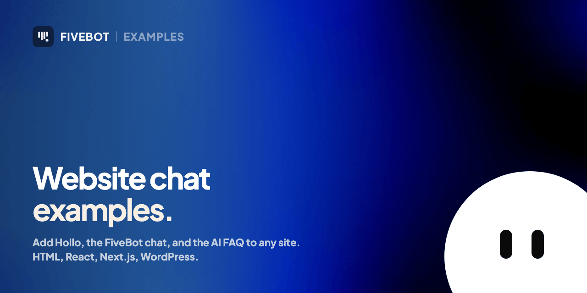

# Website chat examples

How to add Hollo, the [FiveBot](https://fivebot.ai/?utm_source=github&utm_medium=referral&utm_campaign=website_chat_examples) website chat, and the AI FAQ to your site. The chat answers from the same knowledge base as your Discord tickets and cites its source. Visitors don't need a Discord account, and your team replies from Discord or the Hollo inbox.

## Start

1. In the FiveBot dashboard open Settings › Hollo › Install, add a site and list the domains it runs on.
2. Copy the site key (`pk_...`) into the snippet:

```html
<script src="https://fivebot.ai/widget.js" data-key="pk_your_site_key" async></script>
```

That's enough for anonymous visitors. The examples below add sign-in, topics, events and the FAQ.

## Examples

| Folder | What it shows |
| --- | --- |
| [`html`](html) | The snippet, buttons that open the chat on a topic, an unread count in the tab title, and loading only after cookie consent |
| [`faq`](faq) | The AI FAQ embedded in a page, handing over to the chat when a visitor wants a person |
| [`react`](react) | A `<FiveBotChat>` component that loads the chat once and signs users in and out |
| [`nextjs`](nextjs) | App Router layout with `next/script`, signing on the server with Auth.js |
| [`wordpress`](wordpress) | A small plugin: chat on every page, logged-in users signed in |

## Signed-in visitors

Tell the chat who is signed in and your team sees a verified account and email next to the conversation. The visitor gets the same conversations on every device, and a different account on the same browser never sees them.

```js
FiveBot.identify({ externalUserId, signature, name, email });
```

`signature` is an HMAC-SHA256 hex digest of `externalUserId`, a line break and `email`, made with the site's identity secret. Sign on your server only; the secret never goes in the page. Call `FiveBot.reset()` when the user signs out.

Node.js:

```js
import { createHmac } from 'node:crypto';

const signature = createHmac('sha256', process.env.FIVEBOT_IDENTITY_SECRET)
  .update(`${user.id}\n${user.email}`)
  .digest('hex');
```

PHP:

```php
$signature = hash_hmac('sha256', $user_id . "\n" . $email, getenv('FIVEBOT_IDENTITY_SECRET'));
```

Python:

```python
import hashlib, hmac, os

signature = hmac.new(
    os.environ["FIVEBOT_IDENTITY_SECRET"].encode(),
    f"{user_id}\n{email}".encode(),
    hashlib.sha256,
).hexdigest()
```

Signing `externalUserId` alone also works, and then only the account shows as verified.

## Page API

| Call | What it does |
| --- | --- |
| `FiveBot.open({ topic })` | Opens the chat, straight to a topic from your widget settings |
| `FiveBot.on('message:received', fn)` | Events: `loaded`, `opened`, `closed`, `message:sent`, `message:received`, `unread:changed`, `availability:changed` |
| `FiveBot.setLocale('pl')` | Switches language without a reload: `en`, `pl`, `de`, `fr`, `es`, `pt-BR`, `tr` |
| `FiveBot.pushEvent('plan_upgraded', { plan: 'Gold' })` | Adds an event to the visitor's timeline |
| `FiveBot.setSegments(['vip'])` | Segments your team can filter contacts by |
| `FiveBot.showMessage('Need a hand?')` | Shows a message in the chat as your team |
| `FiveBot.openArticle(id)` · `FiveBot.searchArticles('refund')` | Opens a FAQ answer or a search |
| `FiveBot.configure({ position, colorMode, hideOnMobile })` | Overrides the widget settings on this page |
| `data-autoload="false"` + `FiveBot.load()` | Waits until you say so, for example after cookie consent |
| `?fivebot=open` | Opens the chat from a link, as reply emails do |

The full list is in the dashboard next to your site key.

## FAQ embed

```html
<div id="faq"></div>
<script src="https://fivebot.ai/faq.js" data-faq="your-faq-slug" data-target="#faq" data-theme="auto" async></script>
```

`data-theme` is `light`, `dark` or `auto`. `data-header="off"` hides the FAQ title. Visitors can ask anything that isn't listed and get a cited answer. When the chat is on the same page, a visitor who wants a person lands in it.

## Requirements

Hollo and the FAQ page are on the Starter plan and up. See [pricing](https://fivebot.ai/pricing?utm_source=github&utm_medium=referral&utm_campaign=website_chat_examples).

Questions go to [Discord](https://discord.gg/fivebot) or support@fivebot.ai.

## License

[MIT](LICENSE)
